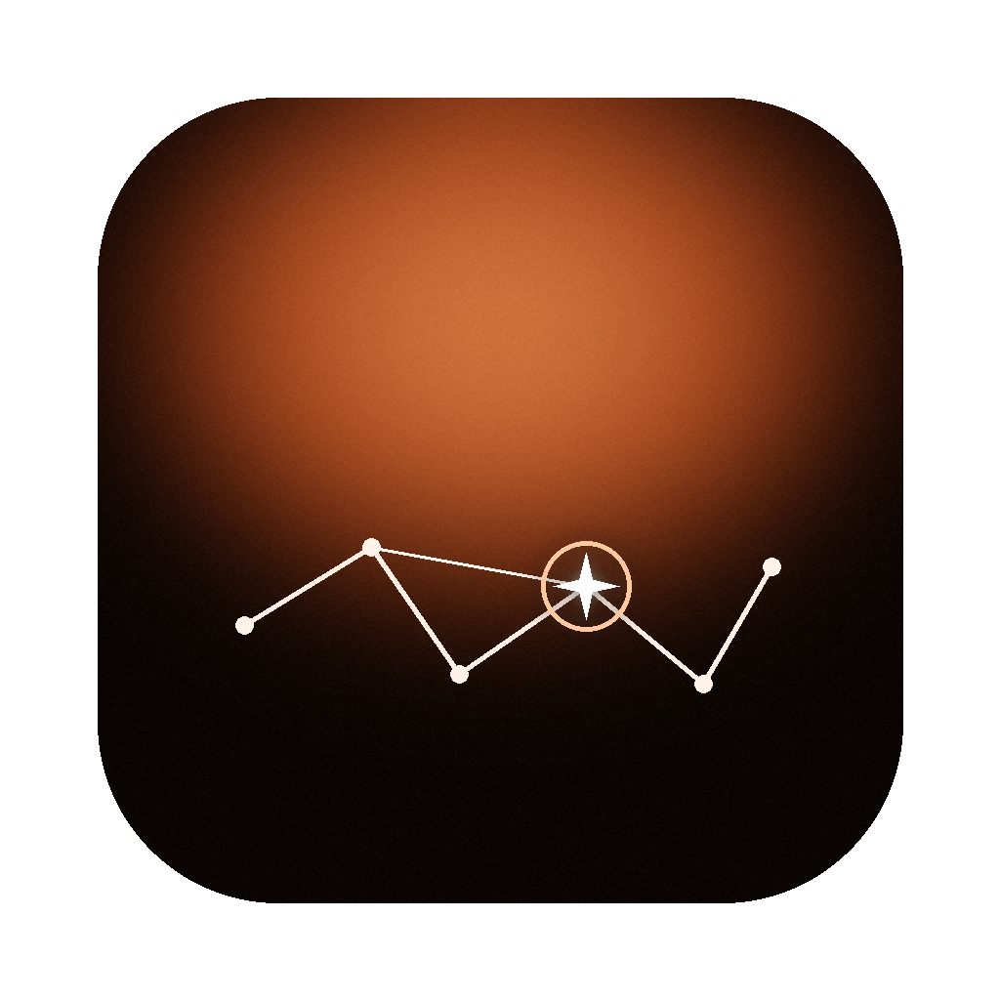
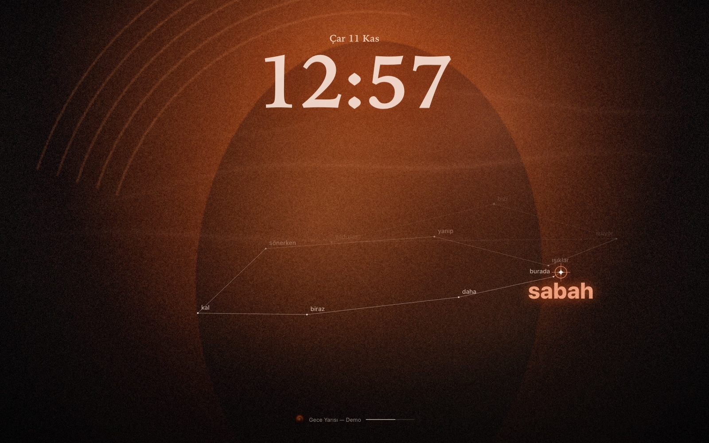
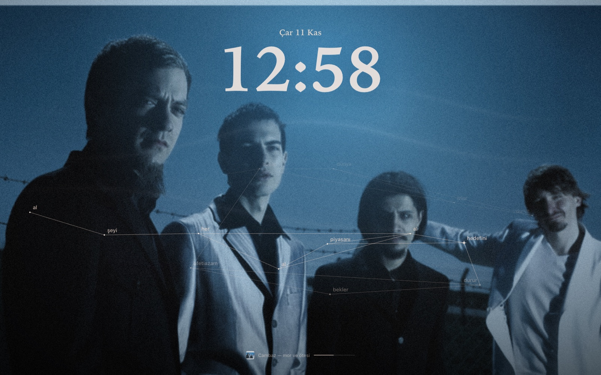
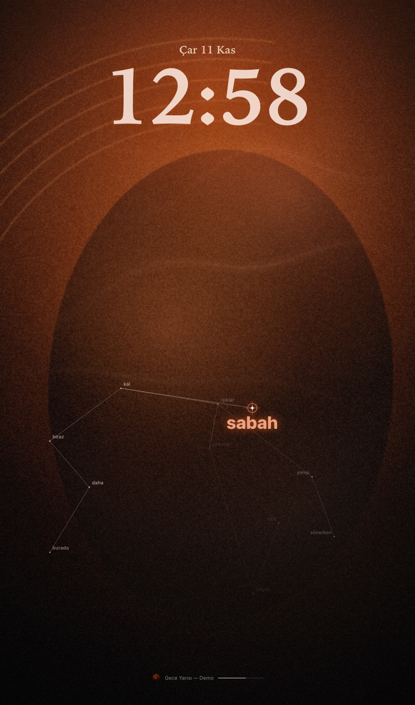

<p align="center"></p>

# GY Now Playing

macOS için hareketli duvar kağıdı, Spotify "şimdi çalıyor" ekranı ve kilit ekranı.
Müzik açınca albüm kapağı ekrana yayılıyor, şarkı sözleri kelime kelime bir takımyıldız gibi beliriyor.
MacBook çentiğini tanıyor, dikey kullandığım ikinci monitörde de kendini dikey düzene alıyor.

Gökhan Yurtsever · 2026

<p align="center"></p>

> Görseller uygulamanın demo modundan alındı. Sözler gerçek bir şarkıya ait değil.

---

## Neden yaptım

Instagram'da bir MacBook kurulumu videosu gördüm: kilit ekranında büyük bir saat, müzik başlayınca albüm kapağı
tüm ekrana yayılıyor, şarkı sözleri de kelime kelime bir yıldız haritası gibi çiziliyordu. iPhone'daki "şimdi çalıyor"
ekranının Mac'te çok daha sinematik bir hâli gibiydi.

Aynısını kendi Mac'imde, Spotify ile ve masamdaki dikey monitörle birlikte istedim. Hazır uygulamalara baktım ama
hiçbiri tam istediğim gibi değildi: kimisi sadece video oynatıyor, kimisi tek ekranda çalışıyor, hiçbiri o an
Spotify'da çalan şarkıya göre değişmiyordu. Ben de kendim yazmaya karar verdim. Bir de arkadaşlarım isterse
USB'ye atıp kendi bilgisayarlarında hiçbir şey kurmadan çalıştırabilsinler istedim; o yüzden her şeyi tek bir
uygulamanın içine topladım.

## Ne yapıyor

- **Masaüstü:** Müzik yokken koyu zemin üzerinde yavaşça hareket eden turuncu ışık, duman ve büyük bir serif saat.
- **Şarkı başlayınca:** Saatin altında kapak kartı beliriyor. Sonra kapak tüm ekrana yayılıyor, tema rengi kapaktan otomatik alınıyor.
- **Sözler:** Senkron sözler kelime kelime takımyıldız gibi akıyor. O an söylenen kelime büyük ve parlak, önceki satırlar yavaşça soluyor.
- **İki ekran:** Her ekran kendi katmanını alıyor. Dikey monitörde saat büyüyor, sözler yukarıdan aşağı akıyor. Monitörü takıp çıkarınca ya da döndürünce kendini yeniden kuruyor.
- **Çentik:** MacBook çentiğinin etrafında, çentiğin gerçek ölçüsünde ince bir parıltı var. Harici monitörde yok.
- **Kilit ekranı:** Mac'i kilitleyince (Ctrl+Cmd+Q) aynı görüntü ekran koruyucu olarak açılıyor, dokununca şifre ekranı geliyor.
- **Menü çubuğu (♪):** Şimdi kilitle, kilitte göster aç/kapa, masaüstünde göster, oturum açılınca başlat, yenile, günlük.

<table>
  <tr>
    <td width="50%" valign="top"><br><sub>Müzik yokken: ışık, duman ve saat</sub></td>
    <td width="50%" valign="top"><br><sub>Dikey monitörde kendini dikey düzene alıyor</sub></td>
  </tr>
</table>

## Nasıl yaptım

```
 Spotify (masaüstü) ──AppleScript──┐
 LRCLIB (senkron söz) ──HTTPS──────┤
                                   ▼
                     GY Now Playing.app  (Swift, menü çubuğunda)
                       ├─ yerel servis (Network.framework)
                       ├─ her ekrana masaüstü seviyesinde WKWebView
                       ├─ kilit yakalayıcı → ekran koruyucuyu başlatır
                       └─ GY Now Playing.saver  (ScreenSaver + WKWebView)
                                   │
                                   ▼
                           tek bir web sayfası
                (canvas animasyon · kapak · takımyıldız sözler)
```

**Görüntü tek bir web sayfası.** Arka plandaki ışık ve duman düşük çözünürlüklü bir canvas'ta çiziliyor; büyütülünce
yumuşak kalıyor ve neredeyse hiç işlemci harcamıyor. Kapak, açık-koyu tonlarına göre kapaktan çıkardığım renge
boyanıyor (duotone) ve üstüne grain ekleniyor. Sözler için her satırın kelimelerini yatayda ya da dikeyde dağıtıp
aralarına çizgiler çekiyorum; o an söylenen kelimeye bir yıldız ve halka koyuyorum.

**Spotify verisi AppleScript ile geliyor.** Spotify Web API'si için geliştirici uygulaması ve token gerekirdi;
masaüstü uygulamasına AppleScript ile sormak hem daha basit hem şarkının kaçıncı milisaniyesinde olduğunu tam
veriyor. Sayfa saniyede bir soruyor, aradaki süreyi kendisi sayıyor.

**Sözler LRCLIB'den.** LRCLIB satır bazında zamanlı söz veriyor. Kelime bazında zaman yok, o yüzden her satırın
süresini kelimelerin harf sayısına göre dağıtıyorum. Bulunan sözler diskte önbelleğe alınıyor.

**Masaüstü katmanı.** Önce Plash'i denedim ama Plash aynı anda tek ekranda çalışıyor. Ben de her ekran için
masaüstü seviyesinde, tıklamaları geçiren bir pencere açan kendi katmanımı yazdım. Ekran değişikliklerini
dinliyor ve sadece değişen ekranı yeniden kuruyor. Çentik ölçüsünü `safeAreaInsets` ve `auxiliaryTopLeftArea /
auxiliaryTopRightArea` ile alıp sayfaya iletiyorum.

**Kilit ekranı.** macOS kilit ekranına web içeriği koymaya izin vermiyor. Ekran koruyucu ise kilit ekranının
üstünde çalışıyor, o yüzden aynı sayfayı ekran koruyucu olarak da paketledim. Ctrl+Cmd+Q ekran koruyucuyu
başlatmadığı için uygulama `com.apple.screenIsLocked` bildirimini yakalayıp ekran koruyucuyu hemen açıyor.

### Yolda karşılaştığım sorunlar

1. **AppleScript'te `st` değişken adı.** `set st to player state` sözdizimi hatası verdi. `st`, `nd`, `rd`, `th`
   AppleScript'te sıra sayıları ("1st") için ayrılmış kelimelermiş; değişkenin adını `pState` yaptım.
2. **Ekran koruyucu siyah ekranda kalıyordu.** Loglara sayfanın durumunu yazdırınca sebebi çıktı: macOS ekran
   koruyucu penceresini "görünmez" sayıyor, WebKit de sayfayı gizli sanıp çizimi askıya alıyordu. WebKit'in
   pencere görünürlüğü algılamasını ve gizli sayfa kısıtlamalarını kapattım; sayfa da ekran koruyucu modunda
   gizli görünse bile çizmeye devam ediyor.
3. **İki saat üst üste.** macOS ekran koruyucunun üstüne kendi kilit ekranı saatini koyuyor. Ekran koruyucu
   modunda kendi saatimi gizledim; saatin fontunu Sistem Ayarları › Duvar Kağıdı › Saat Görünümü'nden seçmek yetiyor.
4. **Başka Mac'te kurulum derdi.** İlk sürümde servis Python'daydı ve kurulum için Terminal gerekiyordu. Servisi
   Swift'e taşıdım; artık servis, duvar kağıdı, kilit yakalayıcı ve ekran koruyucu tek bir uygulamanın içinde.
5. **Intel derlemesi.** macOS 27 geliştirici araçlarında Intel için eski macOS sürümlerine uyum kütüphanesi yok;
   Intel'de en düşük sürümü macOS 14 yaptım.

## Teknik özet

| Konu | Kullandığım |
|---|---|
| Uygulama | Swift, menü çubuğu uygulaması |
| Masaüstü ve kilit ekranı | WKWebView, ScreenSaver çerçevesi |
| Görüntü | Canvas animasyonu, tek sayfa web arayüzü |
| Müzik verisi | Spotify masaüstü uygulaması (AppleScript) |
| Sözler | LRCLIB, diskte önbellek |
| Gereksinimler | Apple Silicon'da macOS 12+, Intel'de macOS 14+, Spotify masaüstü uygulaması |

## Bilinen sınırlar

- LRCLIB'de sözü olmayan şarkıda sadece kapak ve saat görünür. Kelime zamanlaması yaklaşık.
- Ekran koruyucu macOS'un eski tip ekran koruyucu altyapısında çalışıyor; büyük macOS güncellemelerinde davranışı değişebilir.
- Uygulama Apple tarafından imzalı/notarize değil, kişisel bir proje.

## Kaynak kod

Kaynak kod ve uygulama dosyası paylaşılmıyor, bu sayfa projeyi tanıtmak için hazırlandı.
